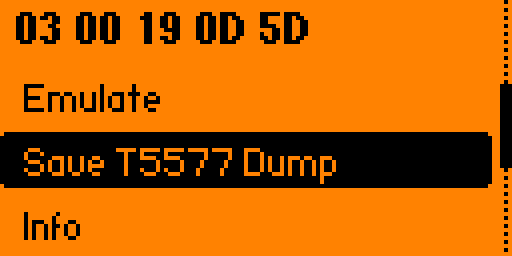
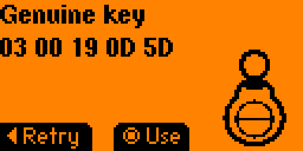
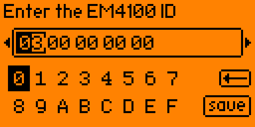
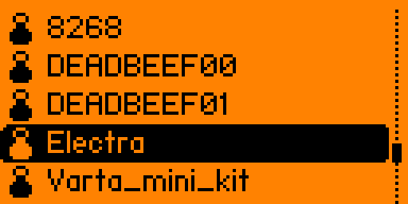
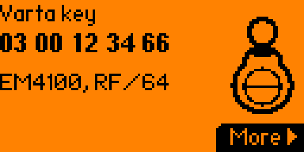
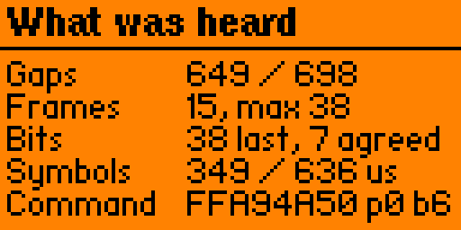

# Varta

Everything you can do with a **Варта-М** intercom key on a Flipper Zero: read one, check
whether it is genuine, open a door by emulating it, write a copy to a blank tag, or build a
working key from nothing but the number printed on the fob.

Варта-М (Varta-M) keys are the black and yellow fobs used by intercoms across Ukraine; the chip
inside is marked АКД-2020М.

It can also tell you what a *reader* wants, without touching a key at all.

## Why a whole app for one key

A Варта-М key is an ordinary T5577 chip broadcasting an EM4100 ID. What makes it awkward is that
the anti-copy scheme is **the same on every key ever made** - one shared password, one shared
marker word hidden in the chip, and the reader checks that marker before it opens.

So a plain EM4100 clone of a Varta key does not work. But the ID is the only thing that differs
between keys, which means **the number on the fob is enough to rebuild the whole key**. That is
what this app does.

---

## Read

Put a key on the Flipper's back and press Read. It finds the ID, then checks the hidden marker
to tell you what you are actually holding.

You get one of several answers, and the useful ones are:

| Result | What it means |
|---|---|
| **Genuine key** | Right ID, right marker. A real Varta key. |
| **Unprotected clone** | The ID looks like a Varta key, but the marker is missing. It will not open a Varta door. |
| **Wrong marker** | Right ID, wrong marker value. |
| **Not an EM4100** | Some other tag was on the coil. |

From here you can emulate the key, look at its details, or save it as a dump to write onto a
blank tag.

## Add Manually

No key to hand? Type the ID in. It is the number printed on the fob, and it is all the app
needs - everything else about a Varta key is the same on every key.

If the number does not start the way Varta IDs usually do, the app says so and lets you decide
whether to carry on. It is a warning, not a refusal - plenty of real keys are unusual.

## Saved

Opens keys you have saved before, and T5577 dumps, from the Flipper's `lfrfid` folder.

## Info

What this particular key is: its ID, and how it broadcasts. **More** shows the five chip blocks
the key is built from, each one labelled with what it is for - handy if you are writing a blank
by hand or checking a dump someone sent you.

## Emulate

Hold the Flipper where the key would go. The door should open.

Emulation sends two different things in turn - the key's ID, then the hidden marker word the
reader is looking for. They have to be sent in **alternating bursts** rather than mixed
together, because the marker is too long to fit in the gap where the reader listens, and its
first few bits look exactly like the start of an ID, which stops the reader recognising either.

`Settings → Emulation` picks how much of each goes into a burst. All three modes send the same
two things in the same order and differ only in the proportions.

| Mode | Sends per loop | Loop period | Notes |
|---|---|---|---|
| **Mode 1** *(default)* | 8 ID frames, then 4 marker words | 327.7 ms | Best compromise. Start here. |
| **Mode 2** | 8 ID frames, then 1 marker word | 278.5 ms | Same ID stretch, thinnest marker. Sweeps fastest — about 2 s. |
| **Mode 3** | 4 ID frames, then 8 marker words | 262.1 ms | Marker-heavy, shortest ID stretch. |

All three opened a real Varta reader. A plain EM4100 ID, sent as a control, did not.

> **Hold the Flipper on the reader for about 15 seconds before trying another mode.** The loop
> is not synchronised to the reader, so the bursts drift through the reader's listening window a
> little further each time round, and a mode that looks dead after 4 seconds has not had a fair
> trial.

## Save T5577 Dump

Writes a `.t5577` file you can open in the T5577 app to program a blank tag. The blank then
behaves like a real key.

---

## Check Reader

This one is not about keys at all. Hold the Flipper against a **reader** and it listens to what
the reader is asking for, then tells you what kind of reader it is.

It only ever listens. Nothing is transmitted, so pointing it at a reader you do not own cannot
change anything.

It will tell you it is a **Varta reader**, meaning your key should open it, or that it uses
**another scheme** - and then it shows you the password that reader asked for. Failing either,
it says what it heard rather than guessing: a carrier with no readable commands, commands it
could not parse, or no reader at all.

A verdict needs six identical readings in a row before the app treats it as settled - a reader
asks its question about thirty times a second, so that takes a fraction of a second once you
have the Flipper in the right spot. If it could not get there, it still shows the answer but
labels it `Unconfirmed`, and stays silent instead of chiming.

**More** shows the raw counts behind any verdict, so you can argue with one you do not believe.

### What it will not tell you

**It will never say a reader is unprotected.** That verdict was built and then taken out again,
because no measurement here could support it. Readers that only read an EM4100 ID look wildly
different from one another - one produced a hundred times more carrier disturbance than another
doing the same job - so every threshold that fit one was wrong for the next. Guessing in that
direction means telling somebody their door opens with a clone, so the app does not guess.

So **"No commands" does not mean unprotected.** It means this app heard nothing it could read,
and a reader that asks in a way it cannot measure looks exactly the same from outside.

If you want to know, there is one reliable test and it is an active one: emulate any EM4100 ID
at the reader. If it opens, it is unprotected, and no inference is involved.
